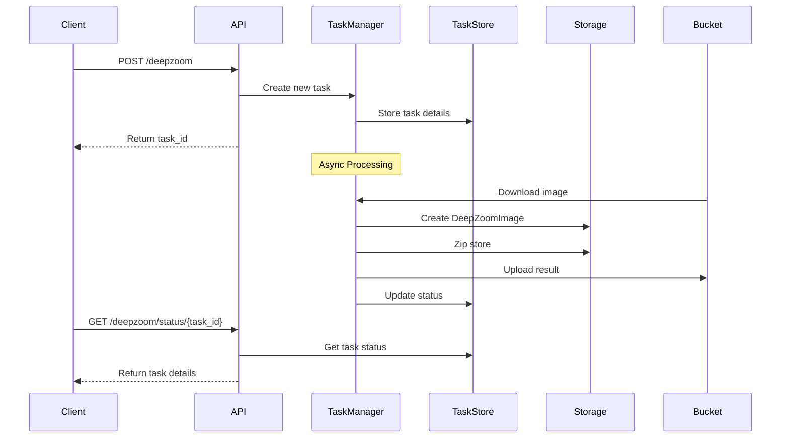

## CreateZoom API

### Pyramiding

This application is an asynchronous endpoint for creating deep zoom image file formats for images, for use with QUINT and other EBrains software. Main dependencies are `asyncio, aiofiles, aiohttp` ,`fastapi` and `pyvips`.
The library `libvips` is installed in the image.

### API Endpoints

- `GET /deepzoom/health` - Service health status
- `POST /deepzoom` - Submit image processing task
- `GET /deepzoom/status/{task_id}` - Check task status

### Deployment

to deploy, run build in docker and the image can be deployed anywhere. There are no secrets as the token is handled in memory.

```bash
docker build -t appname .
```

The container defaults to eight concurrent conversion tasks and two libvips
worker threads per image to keep peak memory bounded. Override
`PROCESS_WORKERS` or `VIPS_CONCURRENCY` at deployment time only when the
container has enough memory for the additional parallel work.

`VIPS_CONCURRENCY` sets software worker threads per image pipeline, not
physical CPU cores. Eight jobs converting at once with `VIPS_CONCURRENCY=2`
can use roughly sixteen libvips worker threads, plus application and I/O threads.

### Usage

```json
{
  "path": "str",
  "target_path": "str",
  "token": "str"
}
```

Files paths should be submitted individually, for each file you will be assigned a `task_id`. You can query your tasks status with the status endpoint.


